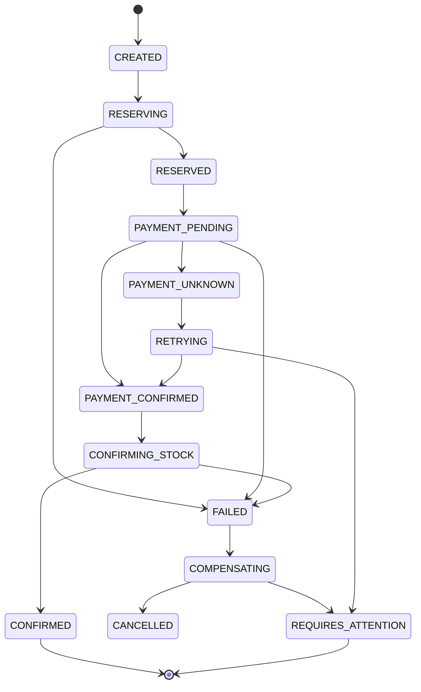

# Saga state machine

The PRD defines the Order service as the saga orchestrator. The state machine is responsible for coordinating reservation, payment, confirmation, cancellation, and reconciliation.

## Saga invariants

1. Every forward step is paired with an idempotent compensation. 
2. A command timeout is treated as `unknown`, not `failed`.
3. The order persists a sub-state such as `PAYMENT_PENDING_CONFIRMATION` before resolving unknown outcomes.
4. Reconciliation continues status polling up to 15 minutes before escalation.
5. Compensations are idempotent and safe to repeat.

## State transitions from the PRD

- `CREATED` -> `RESERVING` -> `RESERVED` -> `PAYMENT_PENDING` -> `CONFIRMED` or `FAILED`
- `FAILED` -> `COMPENSATING` -> `CANCELLED`
- `PAYMENT_UNKNOWN` triggers retry of the same idempotent command using the same idempotency key.
- `REQUIRES_ATTENTION` is the alerting path for unresolved unknown states.

## Important business rules

- No compensation runs before the outcome is provably known.
- Stock release is triggered by a failure or cancellation path and emits `inventory.stock.released`.
- The Order service is the only service orchestrating the distributed transaction.
