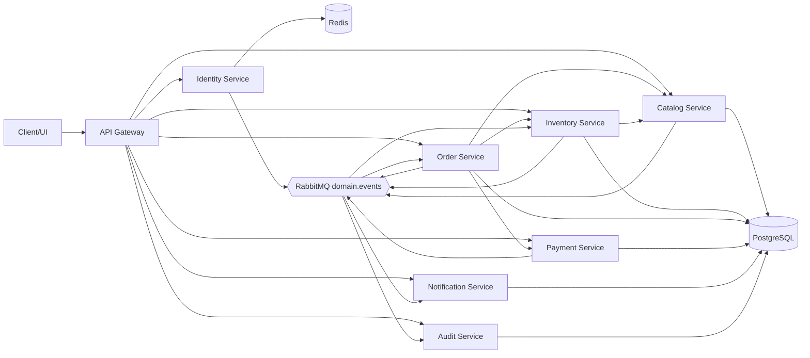

# Service dependency graph

## Dependency notes

- Gateway is the only HTTP-facing component.
- Internal synchronous calls are gRPC only.
- Order service is the orchestrator; Inventory and Payment never call Order synchronously.
- Inventory and Payment publish events rather than owning cross-service orchestration.
- PostgreSQL remains the source of truth; Redis is a hot cache and coordination layer.
